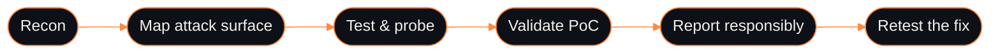

<div align="center">


<p>
  <a href="https://www.linkedin.com/in/ramdhani-hadi-winarno/"></a>
  <a href="https://www.instagram.com/ramdhanihw420"></a>
</p>

</div>

```console
$ whoami
ramdhani hadi winarno  /  fullstack developer  /  bug hunter

$ cat stack.txt
python / typescript / go / php / react / next.js / node / laravel

$ ./now.sh
founder   ->  Nexty Labs
hunting   ->  web & API vulnerabilities
```

<div align="center">

<h3>How I hunt</h3>

</div>



<details>
<summary><b>What I focus on</b></summary>

<br>

- **Web and mobile apps:** React, Next.js, Node, Laravel, and React Native
- **Security research:** bug hunting on web apps and APIs
- **IoT prototypes:** hardware tinkering with Arduino
- **Products:** building and shipping software at Nexty Labs

</details>

<div align="center">

<br>

<h3>Stack</h3>

<sub>LANGUAGES</sub><br>
<br>
<br>
<sub>FRONTEND</sub><br>
<br>
<br>
<sub>BACKEND &amp; DATA</sub><br>
<br>
<br>
<sub>INFRA &amp; SECURITY</sub><br>
<br>
<br>
<sub>DESIGN</sub><br>


<br>
<br>

<h3>Activity</h3>

<p>
  
</p>

<p>
  
  
</p>

</div>

> [!TIP]
> Found a vulnerability in one of my projects? Please report it responsibly through LinkedIn or Instagram. I will respond as soon as I can.

<div align="center">

<sub>Open for collaboration. Say hi, or report a bug responsibly.</sub>


</div>
